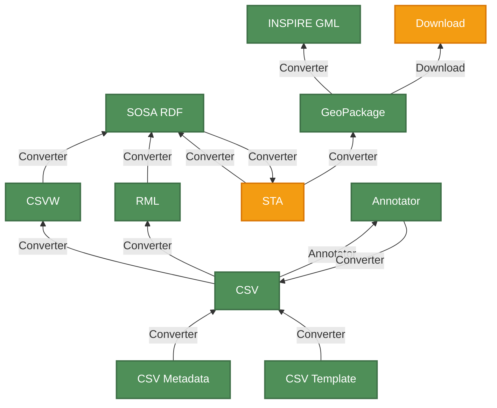

# Soil Observation data encodings - an overview

## Intro
SoilWise provides various formats for soil data encoding. All are based on the same underlying conceptual model, and can be losslessly converted to other SoilWise formats

## Data landscape

Currently all these converters are stored in this [issue](https://github.com/soilwise-he/data-download/issues/13)

### Technology summary

| Technology | Typical users | Typical situation | Pros | Cons |
| --- | --- | --- | --- | --- |
| CSV | Field scientists, lab teams, data managers, project coordinators | When soil data is initially collected or shared as spreadsheets | Fast, familiar, easy to use; suitable for day-to-day collection and conversion | Limited semantics; less suitable for rich interoperability or machine reasoning |
| Standard SoilWise annotation template | Data providers,  scientists and project teams preparing datasets for publication | When a dataset needs a structured template to capture observation metadata consistently | Improves consistency and metadata quality; accessible to non-specialists | Requires careful setup; still not as expressive as full semantic models |
| CSV on the Web (CSV-W) | Data publishers, metadata specialists, web developers | When tabular data must be annotated for machine-readable publication on the web | Adds structure and semantics to tables; good for web publishing and discovery | Can become complex for highly rich observation data; expert knowledge often required |
| R2RML / RML | Data publishers, metadata specialists, ontology specialists | When tabular data must be annotated for machine-readable publication | Strong integration with linked data and semantic workflows | More technical; less intuitive for domain users without data engineering skills |
| SOSA RDF | Semantic web developers, ontology specialists, linked-data integrators | When observation data needs to be represented as RDF using the SSN/SOSA model | Rich machine-readable semantics; integrates well with interoperable linked-data workflows | Requires semantic web tooling and expertise; less intuitive for spreadsheet-first users |
| GML / INSPIRE Soil XML | GIS specialists, agencies, spatial data publishers | When exchanging large geospatial soil datasets through OGC/GML-based services | Standardized for spatial exchange; interoperable in GIS and WFS workflows | Complex syntax; large files; less convenient for everyday data handling |
| SensorThings API (STA) | Client developers, monitoring networks, data service providers, QGIS users | When observation data is accessed dynamically via REST/JSON APIs and filtered in real time | Modern API access; supports live querying and easy integration | More infrastructure dependent; less suitable for static file-based exchange |
| GeoPackage / SQLite / PostGreSQL | GIS teams, database maintainers, soil information systems | When data needs to be stored or exchanged as a relational or geospatial database | Good balance of structure, spatial support, and practical database workflows | More database-oriented; less lightweight than spreadsheets for ad hoc sharing |

### Who uses what in practice

- **Soil scientists** and project teams usually start with CSV, Excel, and OMS-tab because those are the easiest ways to collect and standardize real-world field and lab data.
- **Data managers and publishers** often use CSV-W or RML when they need data to be discoverable and machine-readable across the web or across a research ecosystem.
- **GIS and spatial data specialists** tend to prefer GML, GeoPackage, or SensorThings API when the data is geospatial, must be exchanged with standards, or needs to be consumed in mapping tools.
- **Semantic web and linked-data specialists** use RDF, SOSA, GLOSIS, and RML/R2RML when they need stronger semantic interoperability and integration with broader knowledge infrastructures.

### Common conversion paths in this repository

The project explicitly supports conversion between formats such as:

- CSV -> CSVW
- CSV Template -> CSVW
- CSVW -> SOSA RDF
- SOSA RDF <-> STA
- SOSA RDF <-> GPkg
- GPkg <-> STA
- GPkg <-> INSPIRE GML
- STA -> CSV

This illustrates a practical principle: the same soil observation dataset can begin in a familiar spreadsheet format, be enriched semantically, and then be exposed through GIS, database, or API interfaces depending on the user and use case.

### Short recommendation

- Use CSV / Excel / OMS-tab when the data is created by people in the field or lab.
- Use CSV-W / RML when the goal is publication and machine-readable metadata supplementing the data.
- Use GML or GeoPackage when the data is exchanged through geospatial infrastructures.
- Use SensorThings API when data is consumed or served as an observation service.
- Use RDF when semantic integration matters most.

In short: the technologies are complementary, not competing. They describe the same soil observation reality at different levels of technical depth and for different user communities.

