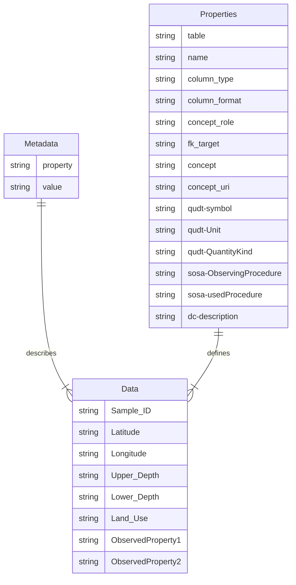
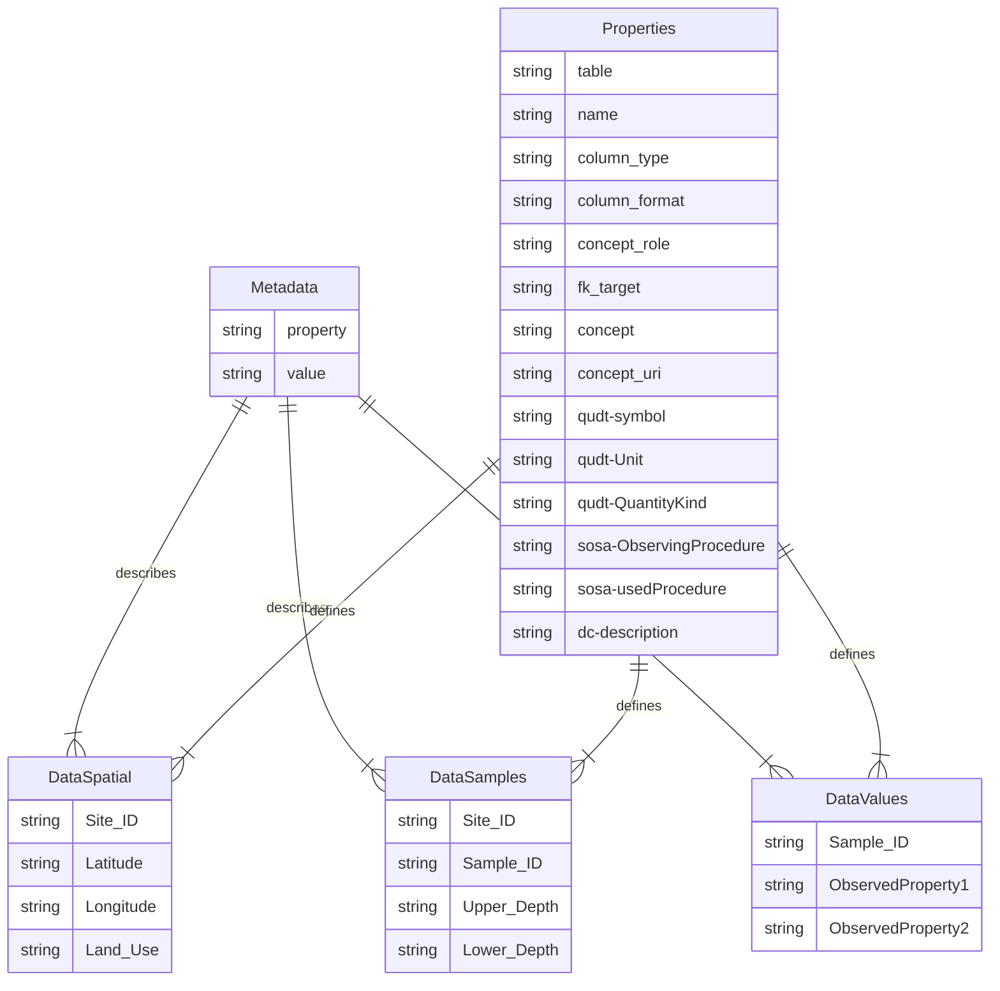
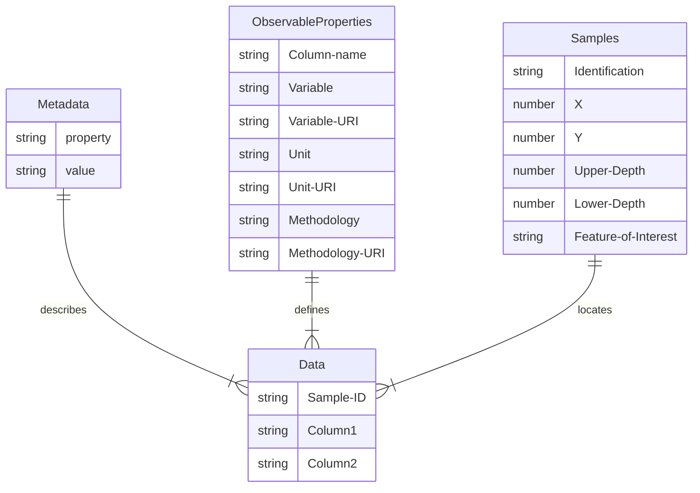

# Simple CSV
A simple approach to providing soil data, where all data is stored either within a single Excel sheet with tabs, alternatively as a set of CSV files.

Notice that this approach is valid for a single campaign only. Only a single method and unit can be used for all observations in a single column. If you need to capture data from different campaigns, using different units or procedures, consider to split the data per campaign. Alternatively, you'll have to create columns per used procedure or unit, e.g. TotalNitrogen-ISO11261 vs. TotalNitrogen-ISO13878. 

The following tables are proposed:

- Metadata: general metadata applicable to the entire dataset. Includes administrative concepts like title, author, license, as well as other generally applicable concepts such as the Coordinate Reference System (CRS)
- Properties: list of all columns in the Data table(s) with all relevant information. For each property you can provide the used Methodology and Unit of Measurement.
- Data: depending on the complexity of the data to be represented, between one and three tables will be required for efficient provision. The Data Values table will always be provided, the other in dependency on the use case:
  - Data Spatial: the spatial aspects of the dataset, where was data surveyed. This may include artifacts of soil survey, e.g. sites, plots, profiles, profile elements such as layers and horizons.
  - Data Samples: in cases where dedicated samples, often referred to as specimens, are taken over time, it can be more efficient to expose them in a separate table, thus avoiding duplication of spatial information over all samples. The reference to the spatial location is provided via a foreign key.
  - Data Values: the actual observation data, columns are the observed properties, rows the samples. In simple surveys, the rows may also contain spatial information
- Inline Code Lists: while in an ideal world, we can provide an external target for the code lists used in the data, in some cases this is not possible, e.g. code list does not exist, or requires concepts from different vocabularies. For these cases, an additional table with these code list values should be provided
- Context: where possible we reference semantic resources via their URI. As the full URI reduces readability, we utilize namespaces. The Context table provides the mapping between these short namespaces and the full URI

## Diagram One Data Table

## Diagram Three Data Tables

## Test the template on your data

- Download the sample Excel sheet in the version suited to your data
  - [Single Table](https://github.com/soilwise-he/soil-observation-data-encodings/blob/main/ExcelTemplates/SoilTemplate_1Tab.xlsx)
  - [Two tables](https://github.com/soilwise-he/soil-observation-data-encodings/blob/main/ExcelTemplates/SoilTemplate_2Tab.xlsx) (Spatial and Data)
  - [Three tables](https://github.com/soilwise-he/soil-observation-data-encodings/blob/main/ExcelTemplates/SoilTemplate_3Tab.xlsx) (Spatial, Samples and Data)
- Copy your observation data to the `DataValues` tab.
- If you are using a separate spatial table, provide the spatial data in the `DataSpatial` tab
- If you are using a separate samples table, provide the samples data in the `DataSamples` tab
- For each column in the data tables, add a line to the Properties tab, and complete the field metadata for that column. 
  - Check relevant vocabularies for available concepts, e.g.:
    - For Observable Properties and Observing Procedures, [soilvoc](https://w3id.org/eusoilvoc) provides uri's.
    - For Spatial Object Types, [GloSIS](http://w3id.org/glosis/model/iso28258/2013/) types are valuable
    - For other concepts, [AgroVoc](http://aims.fao.org/aos/agrovoc/) or the [ENVO](https://obofoundry.org/ontology/envo.html) Ontology can be useful
    - Note: in the `Context` tab, useful semantic resources have been collected, a namespace provided for more concise notation
- Export each of the tabs to a CSV file and upload them to Zenodo or upload your excel into the Soilwise annotator tool to validate the excel and download the dataset in alternate formats, before uploading to Zenodo.

## Analysis Table (csv_metadata between filename and .csv suffix)
- table: Data table name, relevant when multiple data tables are provided
- name: Column Header from original CSV
- column_type: Datatype of the column content
- column_format: Internal formatting of the column content. If the column value is taken from a codelist, the codelist is provided here (either URI or link to CSV representation)
- concept_role: abstract semantic concept this column represents, e.g. sosa:FeatureOfInterest, sosa:Property, schema:Property
- fk_target: Added, if concept_role is foreignKey, the fk columns. If concept type has a value from a result codelist, this codeist
- concept: concept this column represents, e.g. tree, leaf length, soil plot, bulk density
- concept_uri: Link (URI) to a semantic representation of the concept this column represents
- qudt:symbol: Unit of Measurement symbol (qudt:symbol)
- qudt:Unit: Link (URI) to QUDT Unit of Measurement
- qudt:QuantityKind: Link to QUDT Quantity Kind
- sosa:ObservingProcedure: methodology used to determine the concept for the case that the concept_role is a sosa:Property. 
- sosa:usedProcedure: Link (URI) providing more information on the method
- dc:description: description of the column

### Notes
**Concept**: in order to differentiate between simple attributes (provided without context) and sosa properties (provided with observational metainformation), we use schema:Property for simple attributes, sosa:Property for properties provided by sosa:Observation.

**column_type**:  DATA_TYPE_OPTIONS = ['anyURI', 'base64Binary', 'boolean', 'date',
                     'dateTime', 'dateTimeStamp', 'decimal',
                     'integer', 'long', 'int', 'short', 'byte',
                     'nonNegativeInteger', 'positiveInteger', 'unsignedLong',
                     'unsignedInt', 'unsignedShort', 'unsignedByte',
                     'nonPositiveInteger', 'negativeInteger', 'double',
                     'number', 'duration', 'dayTimeDuration', 'yearMonthDuration',
                     'float', 'gDay', 'gMonth', 'gMonthDay', 'gYear', 'gYearMonth',
                     'hexBinary', 'QName', 'string', 'normalizedString', 'token',
                     'language', 'Name', 'NMTOKEN', 'time', 'xml', 'html', 'json']

Additional value: 'codelist'

Inspired by the CSVW documentation that pointed to https://www.w3.org/TR/tabular-data-primer/?ref=stevenfirth.com#datatypes

**concept_role**

- Feature of Interest: sosa:FeatureOfInterest
- Attribute: schema:Property
- Observed Property: sosa:Property
- Spatial: geo:Feature
- Phenomenon Time: sosa:phenomenonTime
- Foreign Key: Foreign Key
- Object Type: geo:Feature

## Base table fit_for_all_temporal_spatial.csv
Information that pertains to all columns, e.g. CRS

- table_key: Unique table name (CSV filename, Excel filename|Tab)
- file_uri: URI to locate the file containing the table
- kind: spatial|temporal
- key: Explanation of what the value represents, e.g. "XY reference system", "sosa:PhenomenonTime"
- value: the value to the key above, e.g. 4326, "2024-05"
- format: Internal formatting of the value

## Context for all URIs

Namespace |	URI
--- | ---
GloSIS-com|http://w3id.org/glosis/model/common/
sosa|http://www.w3.org/ns/sosa/
qudt|http://qudt.org/1.1/schema/qudt#
dcterms|http://purl.org/dc/terms/
geo|http://www.w3.org/2003/01/geo/wgs84_pos#
rdf|http://www.w3.org/1999/02/22-rdf-syntax-ns#
iso11074-2025|https://data.geoscience.earth/ncl/ISO11074v2025/
agrovoc|http://aims.fao.org/aos/agrovoc/
inrae|http://opendata.inrae.fr/thesaurusINRAE/
eusoilvoc|https://w3id.org/eusoilvoc/
gemet|http://www.eionet.europa.eu/gemet/concept/
ansis|http://anzsoil.org/def/au/scm

## Diagram Deprecated

