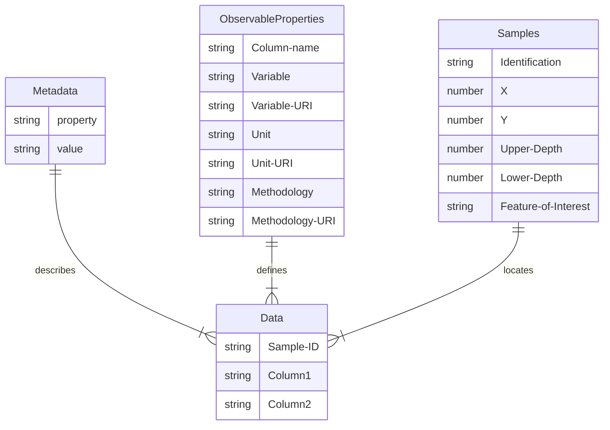

# Simple CSV
A simple approach to providing soil data, where all data is stored either within a single Excel sheet with tabs, alternatively as a set of CSV files.

Notice that this approach is valid for a single campaign only. Only a single method and unit can be used for all observations in a single column. If you need to capture data from different campaigns, using different units or procedures, consider to split the data per campaign. Alternatively, you'll have to create columns per used procedure or unit, e.g. TotalNitrogen-ISO11261 vs. TotalNitrogen-ISO13878. 

The following tables are proposed:

- Metadata: general metadata applicable to the entire dataset. Includes administrative concepts like title, author, license, as well as other generally applicable concepts such as the Coordinate Reference System (CRS)
- Properties: list of all columns in the Data table(s) with all relevant information. For each property you can provide the used Methodology and Unit of Measurement.
- Data: depending on the complexity of the data to be represented, between one and three tables will be required for efficient provision. The Data Values table will always be provided, the other in dependency on the use case:
  - Data Spatial: the spatial aspects of the dataset, where was data surveyed. This may include artifacts of soil survey, e.g. sites, plots, profiles, profile elements such as layers and horizons.
  - Data Samples: in cases where dedicated samples, often referred to as specimens, are taken over time, it can be more efficient to expose them in a separate table, thus avoiding duplication of spatial information over all samples. The reference to the spatial location is provided via a foreign key.
  - Data Values: the actual observation data, columns are the observed properties, rows the samples. In simple surveys, the rows may also contain spatial information
- Inline Code Lists: while in an ideal world, we can provide an external target for the code lists used in the data, in some cases this is not possible, e.g. code list does not exist, or requires concepts from different vocabularies. For these cases, an additional table with these code list values should be provided
- Context: where possible we reference semantic resources via their URI. As the full URI reduces readability, we utilize namespaces. The Context table provides the mapping between these short namespaces and the full URI

## Diagram

## Test the template on your data

- Download the [sample Excel sheet](https://github.com/soilwise-he/soil-observation-data-encodings/raw/refs/heads/main/SimpleCSV/SoilTemplate.xlsx).
- Copy your observation data to the `data` tab.
- Copy your samples data to the `samples` tab (make sure the samples are properly referenced from the data tab).
- For each observed property column in the data tab, add a line to the ObservableProperties tab, and complete the field metadata. 
- Check vocabularies such as the [soilvoc](https://w3id.org/eusoilvoc) if relevant uri's are available for the properties and procedures you have used.
- Export each of the tabs to a CSV file and upload them to Zenodo or upload your excel into the Soilwise annotator tool to validate the excel and download
  the dataset in alternate formats, before uploading to Zenodo.
